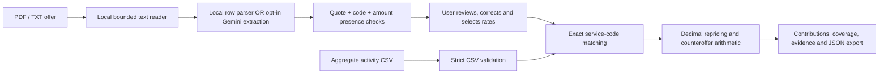

# Architecture

One local Python service serves one buildless frontend. No database or cloud deployment. `/clinic` retains the earlier capacity-planning tool as a separate screen.

PDFs are processed in a child process with a wall timeout and CPU limit; Linux additionally gets an address-space limit. macOS does not reliably support that memory limit. The application limits input bytes, pages, extracted text, rate rows, and CSV rows. No temporary media files are written. Gemini requests contain extracted contract text only, require explicit disclosure acknowledgement, have no automatic retries and use a semaphore of two. A browser navigation does not guarantee cancellation of an already-sent provider request.

## Endpoints

- GET `/api/config`: provider availability only; no credentials.
- POST `/api/extract`: `{name, content: base64, mode: local|gemini, consent}` → pages, rate candidates, source flags, limitations and optional token usage.
- POST `/api/reprice`: `{activity_csv, rates: [{code, rate}], confirmed: true, uplift_pct?: 0..30}` → matched/unmatched rows, subtotals, coverage, limitations.
- GET `/samples/offer.txt`, `/samples/activity.csv`: synthetic example files.
- GET `/api/health`, `/api/schema`, `/api/example`, POST `/api/analyze`: original capacity calculator endpoints.

Extracted rates are candidates, not trusted instructions. Plain-text DOM rendering prevents document HTML from executing. The server serves only explicit static paths, rejects foreign Origin POST requests, and never logs bodies, document text, or credential values. The environment file stays ignored. This is a local prototype, not a hardened multi-user document service.
