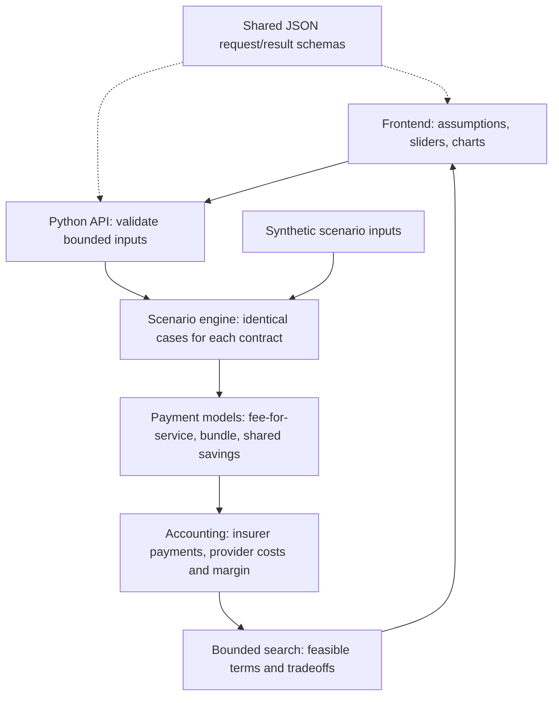

# Architecture and implementation outline

The current scaffold implements static frontend delivery and GET /api/health. All simulation components below are planned.

## Implementation order

1. Define payment formulas, units, episode boundaries, shared-savings benchmark and eligibility assumptions. Hand-check examples.
2. Define shared JSON request/result schemas and enforce input bounds in Python.
3. Implement pure model functions and arithmetic/accounting tests.
4. Evaluate all contracts against identical synthetic scenarios; expose assumptions and reproducible results.
5. Add bounded search across contract terms. Return feasible alternatives or an explicit no-solution result.
6. Connect frontend controls and charts; verify one complete demo flow.

## Boundaries

Use one local Python process to serve the frontend and API. No database, cloud deployment, external provider, or secret is necessary. The local .env is ignored and currently unused; add one configuration loader only if integrations are introduced. A future language model may explain computed results but must not produce financial figures or claim clinical efficacy. All public-data integrations are out of scope for the starter.
