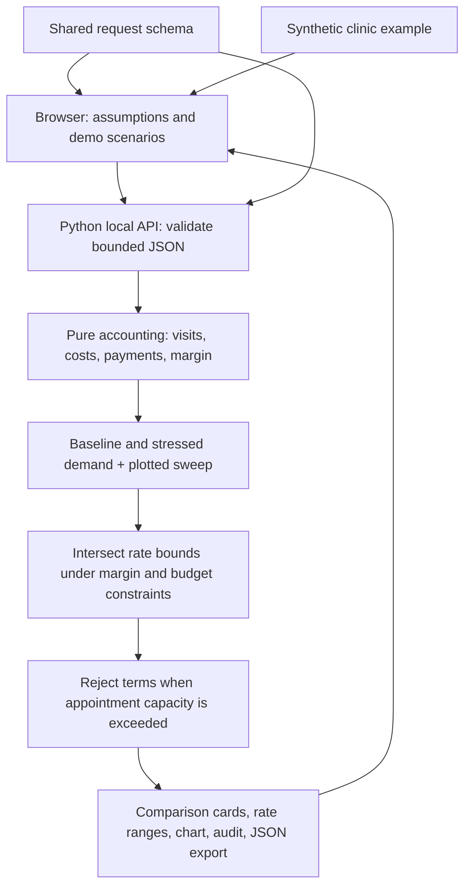

# Community clinic contract calculator

## Implemented

- One plain HTML/CSS/JavaScript frontend and one standard-library Python server.
- Two models: per-visit reimbursement and per-enrolled-patient monthly payment for the same defined clinic services.
- Analytical feasible-rate intervals; no stochastic or AI optimization.
- Bounded schema-driven input validation, 16 KB request limit, static-file allowlist, local-only binding.
- No external provider, database, credentials, persistence, or deployment changes.
- Browser changes invalidate stale results and cancel superseded requests. Each calculation is small and synchronous; asynchronous jobs are unnecessary here.

## API

- `GET /api/health`: health and implementation status.
- `GET /api/schema`: input schema including labels, bounds, and defaults.
- `GET /api/example`: fictional clinic inputs.
- `POST /api/analyze`: validated inputs to deterministic result; see shared result schema.

See model.md for formulas, objective, assumptions, and limitations. A future AI explainer could summarize already-calculated results but is not necessary for the current product.
